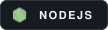

## Hi there, my name is [Egor](https://github.com/briliov) ✦
**STATUS:** \
\- Python Developer Course (Extended) at [Yandex Practicum](https://practicum.yandex.ru) \
\- Learning Algorithms at [Yandex Education](https://yandex.ru) \
\- Practicing on [CodeRun](https://yandex.ru) \
**FOCUS:** Backend Architecture & Creative Logic

---

### ✦ TECH STACK

---
<!-- 
### ✦ PROGRESS & SKILLS

 -->

<!-- #### Educational platforms & Roadmaps

 -->

# Test

<!-- TECH_STACK:START -->
  
  
  
  
  
  
  
  
  
 
  
  
  
  
 
  
  
  
 
  
  
  
  
 
  
  
  
  
  
  
  
  
  
  
  
<!-- TECH_STACK:END -->

